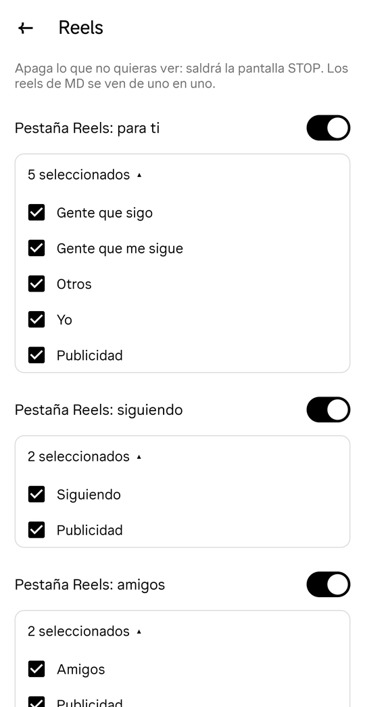
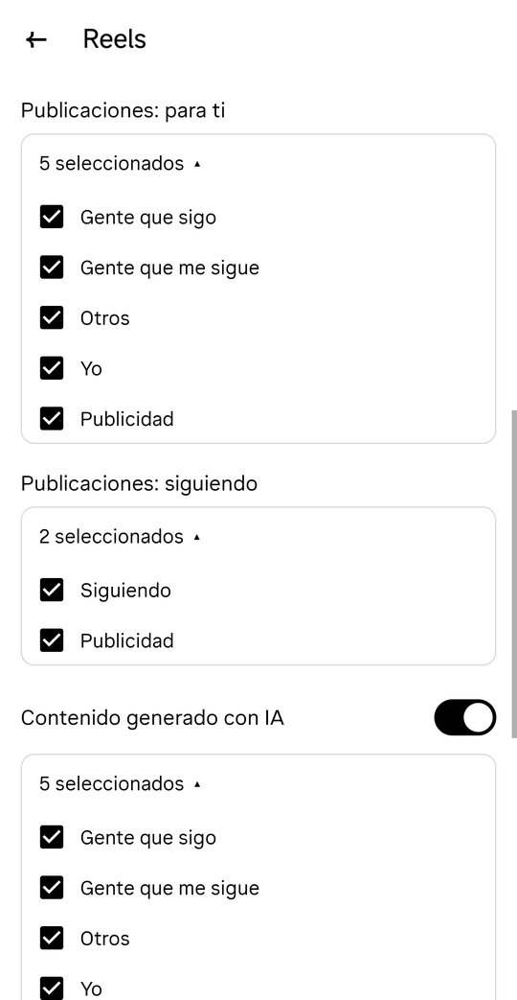
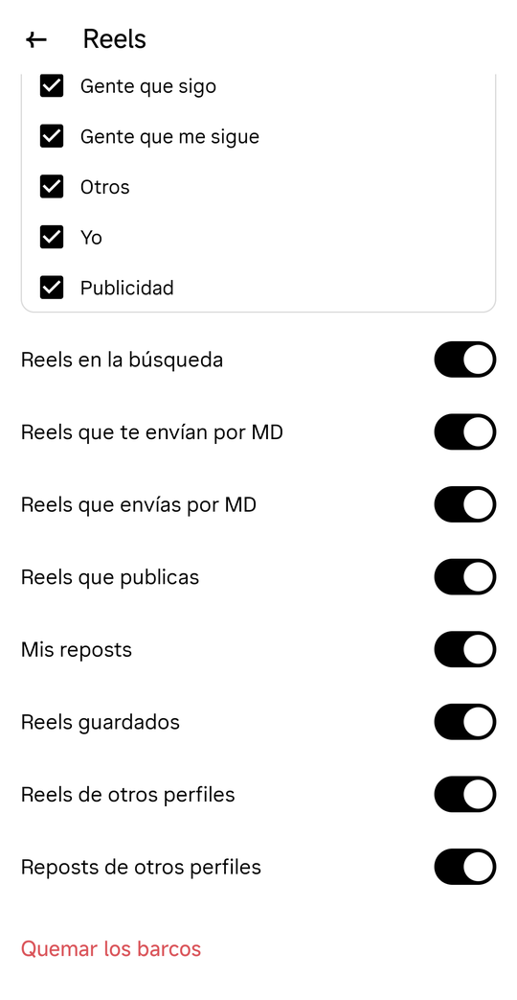
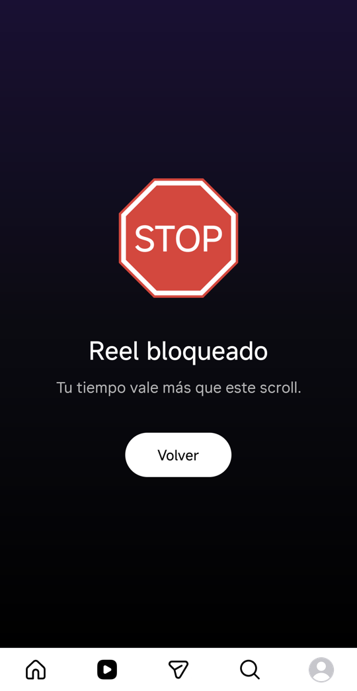

# noreel

Patch your **own** Instagram for Android so Reels stop being an endless scroll —
not hidden behind willpower, but enforced by the app itself. Out of the box
everything is allowed; you decide what to turn off in a **Reels** settings page,
and you can lock those settings for good.

Everything else (feed photos, stories, DMs, search, profile) keeps working.

**Reference version:** Instagram **451.0.0.45.80** (arm64, Android 16 / HyperOS).
Other versions may need the patterns in `patch.py` adjusted.

## Settings

*Settings and activity → How you use Instagram → **Reels***: a full‑screen page
with Instagram‑style switches and multiple‑choice boxes. Everything is enabled by
default (shown below with every option on and every box expanded).

| | | |
|:---:|:---:|:---:|
|  |  |  |

| Setting | What it controls |
|---|---|
| **Reels tab: for you** (switch + box) | *For you* mode of the Reels tab. Options: people I follow, people who follow me, others, me, ads. Switch off = permanent STOP in that mode. |
| **Reels tab: following** (switch + box) | *Following* mode (reels from accounts you follow). Options: following, ads. |
| **Reels tab: friends** (switch + box) | *Friends* mode (reels your friends interacted with). Options: friends, ads. |
| **Posts: for you** (box) | Reels (every video is a reel now) and ads in the home feed (*For you* and *Favorites*). Options: people I follow, people who follow me, others, me, ads. |
| **Posts: following** (box) | Reels and ads in the *Following* home feed. Options: following, ads. |
| **AI‑generated content** (switch + box) | Any post that Instagram marks as AI (the *AI info* label, C2PA metadata or self‑disclosure), reel or photo. Applies everywhere, on top of every other setting. Options: people I follow, people who follow me, others, me, ads. |
| Reels in search | Explore (magnifier) grid and search results. |
| Reels sent to you / you send in DMs | Reels in chats (preview and viewer). |
| Reels you post | Your own profile (grid and Reels tab). |
| My reposts / Saved reels | Your reposts tab and Saved (grid and *All posts* list). |
| Reels on other profiles / Reposts on other profiles | Other people's profiles (grid, Reels tab, reposts tab, *All posts* list). |
| **Burn the boats** | After a warning and a 10 s countdown, the Reels page disappears from the menu and the current settings stay as they are. Only clearing Instagram's cache or data, or reinstalling, brings it back. |

## Features

**No way to escape, by design.** Allowing something never opens the door to the
endless feed:

- Reels opened from a **DM** (received or sent), or from a **post in the home
  feed**, play **one at a time**: swiping to another reel shows STOP and closes
  the viewer, even with everything enabled. A shared reel never becomes a way
  into the general feed.
- Saved reels, reposts, your reels and other profiles' reels only show
  **exactly that** content: their viewer can be scrolled, but it only contains
  those reels.
- The Reels tab always shows its **For you** / **Friends** header, so you always
  know (and choose) which mode you are in, and each mode follows its own box.

**Reels tab**

- Reels that are not allowed are **filtered out** of the list before they reach
  the viewer. If one still shows up (e.g. from Instagram's cache), the viewer
  **skips it automatically**; after 10 blocked reels in a row the mode closes
  with a permanent STOP (no scrolling). Anything that shows up blocked is
  covered with STOP and **muted**.
- A mode that is switched off, or has no option checked, is a permanent STOP:
  no scrolling, nothing plays, but the header still lets you switch mode.

**Home feeds** (*For you*, *Following*, *Favorites*)

- Every video is a reel now; photos are not. Posts you keep allowed stay
  untouched.
- **Ads** you don't want are **filtered out**, reel or photo alike (if you
  don't want ads as reels, you don't want them as photos either), including
  multi‑ad blocks — no blank gap is left.
- Any other reel that is not allowed is covered with the STOP screen at its own
  size (16:9 included), muted, and tapping it shows the full STOP screen. Your
  own post right after uploading is covered too (the upload progress row is
  not).

**Everywhere else** (Explore, search, saved, profiles, reposts, DMs)

- Items that are not allowed are covered with the STOP screen in place; opening
  them shows the full‑screen **STOP** screen in your phone's language, with a
  **Go back** button. In Explore and in reposts tabs everything opens in the
  reels viewer, so every item is covered.
- Long‑pressing a covered item does nothing (it would otherwise preview it).
- Screens that are none of the above (e.g. *who viewed your story*) are never
  covered.

**AI‑generated content** works like ads: reel or photo, the post is blocked.
It is detected only when Instagram marks it (label, C2PA metadata or
self‑disclosure); unmarked posts cannot be told apart. A single photo of a
carousel cannot be blocked on its own, because Instagram marks the whole post.

<p align="center"><br>
<em>The Reels tab with everything blocked</em></p>

> This repo contains **only scripts and patch code**. It does not ship any
> Instagram APK. You extract the APK from your own phone and patch it locally.

## Why

App blockers (screen‑time apps, NFC "brick" style blockers) rely on Android's
accessibility / usage‑access services. On some ROMs (e.g. Xiaomi HyperOS) those
only work while the blocker is allowed to auto‑start, and turning that off is
enough to open the blocked app again. Removing the feature from the app itself
has no off switch.

## How it works

Instagram's code is obfuscated with redex and class names change every release,
so `patch.py` locates its targets by structure and by the
`__redex_internal_original_name` fields redex leaves behind:

| Target | Patch |
|---|---|
| `IgTab` tab list | `CLIPS` kept (its content is filtered); optionally removes `SEARCH` |
| Feed item JSON parser | drops `clips_netego` / `vibes_in_feed_unit` units; `media_or_ad` items go through `Gate.keepFeedReel` (ads filtered per settings) |
| `ClipsFragmentFactory` | the viewer/tab creation asks `Gate` (by `ClipsViewerConfig` source); otherwise `BlockedFragment` |
| Fragment‑by‑name factory used by `ModalActivity` | same, for reels opened from DMs / notifications |
| Clips viewer data controller | new items filtered by `Gate.filterClips` (Reels tab) |
| Generic `RecyclerView` adapter / `bindViewHolder` / chat message binders | `Gate.bound*`: covers items that are not allowed |
| `ContextualFeed` adapter | `Gate.filterFeed` (Following / Favorites / Saved lists) |
| `Fragment.performCreate` / `performResume` | `Gate` tracks the current screen (feed mode, single‑reel viewers) |
| Settings (`settings2`) definitions and navigator | the `REELS_SECOND` row becomes the **Reels** page |
| `Media` / `User` getters (author, follow status, `injected`, AI label/detection, carousel) | read by `Gate` (by reflection, names filled in by `patch.py`) to classify each item |

The logic lives in plain Java (`java/src`: `Gate`, `Settings`, `BlockScreen`)
compiled to smali; `smali/com/igsinreels/Blocker.smali` and
`BlockedFragment.smali` hold the few calls that need obfuscated names, which
`patch.py` fills in.

Only `base.apk` is modified (about a dozen of its dex files). It is then merged with the
unmodified splits into a single APK ([APKEditor](https://github.com/REAndroid/APKEditor))
and signed, so it installs with a plain `adb install` or by tapping the file
on the phone. The STOP screen is plain Java (`java/src`) compiled to smali.

## Reverse engineering with REA

The analysis was done by an AI agent (Claude Code) using
[REA](https://github.com/morluto/rea), an MCP server / CLI for reverse
engineering binaries and apps. For Android, REA wraps a headless JADX engine
and returns evidence-backed results (APK SHA-256, engine version, raw output).

REA was used to load the 240 MB `base.apk` (~183k classes) and search its
classes without the source code (`inspect-android-class`/`-method` can then
decompile a given class or method):

```sh
export REA_JADX_MCP_JAR=/path/jadx-headless-mcp-0.7.1-all.jar
npx -y rea-agents search-android-classes /path/base.apk ClipsTab --json
```

Since almost every class is obfuscated (`X.09Vp`, `X.04WZ`...), name search
only finds a few classes. The actual targets were found by combining that with
baksmali, `grep` over the smali for strings (`"CLIPS"`, `"clips_netego"`,
`"media_or_ad"`) and redex's original class names, plus `adb logcat` stack
traces (e.g. a temporary log in the `ClipsViewerFragment` constructor showed
exactly which factory created it). `patch.py` turns those findings into
structural patterns, so the same script works on 451.0.0.0.75 and
451.0.0.20.80 (the second one only needed one regex to be generalized).

## Usage

Requirements: Linux/macOS, Java 17+, Python 3.10+, `adb`, a phone with USB
debugging (on Xiaomi also enable *Install via USB*).

```sh
./setup-tools.sh                    # smali, baksmali, uber-apk-signer, APKEditor -> tools/
./pull.sh                           # pulls base.apk + splits -> apks/<version>/
./build.sh apks/<version>           # patches, merges, signs -> out/<version>/instagram-noreel-<version>.apk
adb uninstall com.instagram.android # first time only (different signature)
./install.sh out/<version>
```

`build.sh` creates a signing key in `keystore/` on first run. **Back it up**:
updates installed with the same key keep your login; a new key means
uninstalling again.

To also remove Explore (the search tab): `IGSR_REMOVED_TABS=CLIPS,SEARCH ./build.sh apks/<version>`.

Rebuild the Java part after editing `java/src`: `./java/build.sh`
(needs the Android SDK, platform 34).

Tested on Instagram 451.0.0.0.75 and 451.0.0.45.80 (arm64, Android 16 /
HyperOS).

## Known issues

- No Play Store updates: repeat pull → build → install for each new version.
- Meta's preinstalled *Facebook Services* rejects the re‑signed app and may show
  a crash dialog (used for the in‑app browser). Removing it for your user fixes
  it: `adb shell pm uninstall -k --user 0 com.facebook.services`
  (restore: `adb shell cmd package install-existing com.facebook.services`).

## Disclaimer

Not affiliated with Meta or Instagram. Modifying the app may break Instagram's
Terms of Use; use at your own risk, on your own account and device.

## License

MIT
